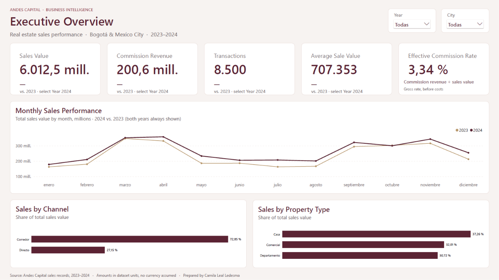
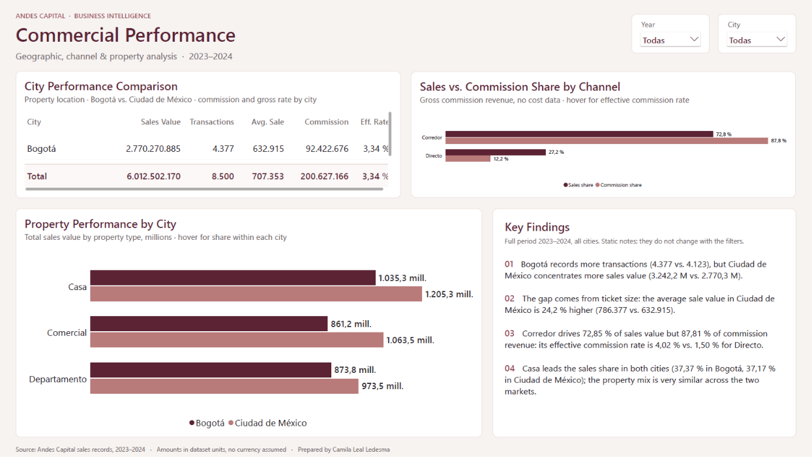

# Andes Capital | Real Estate Business Intelligence

**Python · Pandas · Power BI · DAX · Business Analytics**

🌐 **English** · [Español](README_ES.md)

An end-to-end Business Intelligence project analyzing real estate sales across Bogotá and Mexico City during 2023–2024. The project combines data validation, business analysis, dimensional modeling, and an interactive Power BI dashboard.

---

## Contents

1. [Executive Summary](#executive-summary)
2. [Business Questions](#business-questions)
3. [Dashboard](#dashboard)
4. [Key Findings](#key-findings)
5. [Data Quality and Validation](#data-quality-and-validation)
6. [Recommendations](#recommendations)
7. [Methodology](#methodology)
8. [Limitations](#limitations)
9. [Repository Structure](#repository-structure)
10. [How to Run](#how-to-run)
11. [About This Project](#about-this-project)

---

## Executive Summary

- **Sales grew 11.14% in 2024**, primarily driven by transaction growth (+10.14%) rather than average sale value (+0.91%).
- **8,500 transactions generated 6.01 billion in recorded sales value** and 200.63 million in commission revenue during 2023–2024.
- **The broker channel generated 87.81% of commission revenue**, accounting for 72.85% of sales value.
- **Mexico City led in sales value**, while Bogotá recorded more transactions.

---

## Business Questions

1. What drove sales growth in 2024?
2. Which channels generated the most sales and commissions?
3. How did performance differ between Bogotá and Mexico City?
4. Which property categories contributed most to sales?

---

## Dashboard

The Power BI dashboard includes two pages:

**Executive Overview** — Sales KPIs, year-over-year performance, monthly trends, and commercial composition.



**Commercial Performance** — Geographic comparisons, channel performance, and property-level analysis.



[Power BI Report](powerbi/Andes_Capital_Business_Intelligence.pbix) · [PDF Preview](powerbi/Andes_Capital_Business_Intelligence.pdf)

---

## Key Findings

### 1. Growth was primarily volume-driven

| Metric | 2024 YoY |
|---|---:|
| Sales Value | +11.14% |
| Transactions | +10.14% |
| Average Sale Value | +0.91% |
| Commission Revenue | +11.78% |

### 2. Broker was the leading commission channel

The broker channel generated **87.81% of total commissions**, with an effective commission rate of **4.02%**, compared with **1.50%** for direct sales.

### 3. Geographic performance differed

Mexico City generated **3.24 billion** in recorded sales value across **4,123 transactions**, while Bogotá generated **2.77 billion** across **4,377 transactions**.

Houses were the leading property category in both cities, representing **37.26%** of total sales value.

---

## Data Quality and Validation

Validated **8,500 sales, 3,500 customer records, and 8,000 property records**, checking missing values, duplicates, key integrity, date coverage, and cross-table consistency.

Commission calculations were reviewed against the recorded amounts, which were preserved for financial reporting.

---

## Recommendations

1. **Monitor transaction volume and average sale value separately** to understand growth drivers.
2. **Evaluate broker-channel costs** before making profitability-based decisions.
3. **Track geographic and property-level performance** to support commercial planning.

---

## Methodology

| Step | Focus | Tools |
|---|---|---|
| 1 | [Data exploration and validation](notebooks/01_data_exploration.ipynb) | Python, Pandas |
| 2 | [Data preparation](notebooks/02_data_preparation.ipynb) | Python, Pandas |
| 3 | [Business analysis](notebooks/03_business_analysis.ipynb) | Python, Pandas |
| 4 | Dashboard and data modeling | Power BI, Power Query, DAX |

A star schema connects sales transactions with customer, property, and date dimensions.

---

## Limitations

- Currency standardization across markets is not documented.
- Operating costs are unavailable; commission revenue is not net profit.
- Customer repurchase analysis is limited to the observed 2023–2024 period.
- Geographic differences are descriptive, not causal.

---

## Repository Structure

```text
andes-capital-business-intelligence/
├── data/
│   ├── raw/
│   └── processed/
├── notebooks/
│   ├── 01_data_exploration.ipynb
│   ├── 02_data_preparation.ipynb
│   └── 03_business_analysis.ipynb
├── powerbi/
│   ├── capturas/
│   ├── Andes_Capital_Business_Intelligence.pbix
│   └── Andes_Capital_Business_Intelligence.pdf
├── README.md
└── README_ES.md
```

---

## How to Run

1. Open the notebooks in numerical order to review the analysis.
2. Open the `.pbix` file in Power BI Desktop.
3. If necessary, update the CSV source paths to the files in `data/processed/`.

The PDF and dashboard screenshots can be viewed without Power BI.

---

## About This Project

Developed by **Camila Leal Ledesma** as an educational Data Analytics and Business Intelligence portfolio project, extending a real estate analysis exercise through data validation, business insights, and interactive reporting.

[LinkedIn](https://www.linkedin.com/in/camila-leal-ledesma/) · [GitHub](https://github.com/camilalealle)