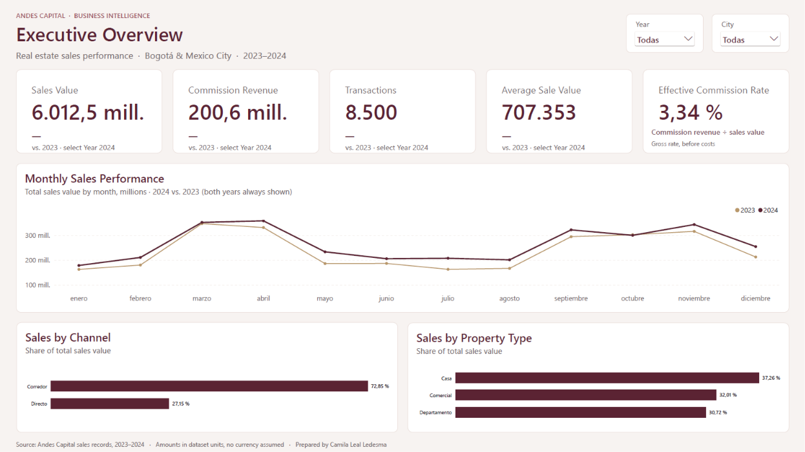
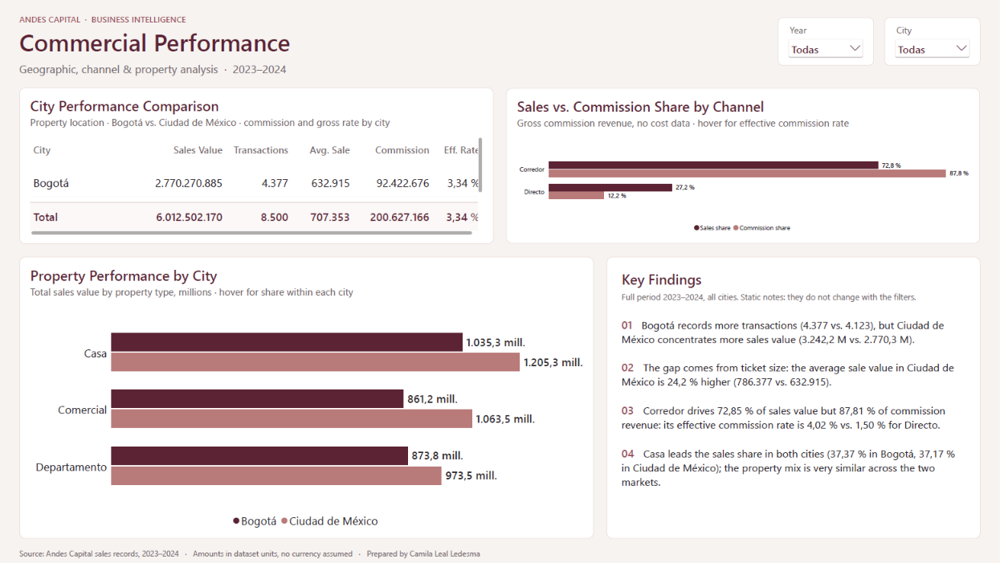

# Andes Capital | Inteligencia de negocios inmobiliarios

**Python · Pandas · Power BI · DAX · Business Analytics**

🌐 [English](README.md) · **Español**

Proyecto integral de Business Intelligence que analiza las ventas inmobiliarias de Bogotá y Ciudad de México durante 2023–2024. Combina validación de datos, análisis de negocio, modelado dimensional y un dashboard interactivo en Power BI.

---

## Índice

1. [Resumen ejecutivo](#resumen-ejecutivo)
2. [Preguntas de negocio](#preguntas-de-negocio)
3. [Dashboard](#dashboard)
4. [Hallazgos principales](#hallazgos-principales)
5. [Calidad y validación de datos](#calidad-y-validación-de-datos)
6. [Recomendaciones](#recomendaciones)
7. [Metodología](#metodología)
8. [Limitaciones](#limitaciones)
9. [Estructura del repositorio](#estructura-del-repositorio)
10. [Cómo ejecutar el proyecto](#cómo-ejecutar-el-proyecto)
11. [Acerca del proyecto](#acerca-del-proyecto)

---

## Resumen ejecutivo

- **Las ventas crecieron un 11,14 % en 2024**, impulsadas principalmente por el aumento de transacciones (+10,14 %) y no por el valor promedio de venta (+0,91 %).
- **8.500 transacciones representaron 6.010 millones en valor comercializado** y 200,63 millones en ingresos por comisiones durante 2023–2024.
- **El canal Corredor generó el 87,81 % de las comisiones**, concentrando el 72,85 % del valor vendido.
- **Ciudad de México lideró en valor comercializado**, mientras Bogotá registró más transacciones.

---

## Preguntas de negocio

1. ¿Qué impulsó el crecimiento de las ventas en 2024?
2. ¿Qué canales generaron más ventas y comisiones?
3. ¿Cómo se comparan Bogotá y Ciudad de México?
4. ¿Qué tipos de propiedad contribuyeron más a las ventas?

---

## Dashboard

El dashboard de Power BI contiene dos páginas:

**Executive Overview** — Indicadores comerciales, crecimiento interanual, evolución mensual y composición de ventas.



**Commercial Performance** — Comparaciones geográficas, desempeño por canal y análisis por tipo de propiedad.



[Reporte Power BI](powerbi/Andes_Capital_Business_Intelligence.pbix) · [Vista previa PDF](powerbi/Andes_Capital_Business_Intelligence.pdf)

---

## Hallazgos principales

### 1. El crecimiento estuvo impulsado por el volumen

| Indicador | Variación 2024 |
|---|---:|
| Valor comercializado | +11,14 % |
| Transacciones | +10,14 % |
| Valor promedio de venta | +0,91 % |
| Ingresos por comisiones | +11,78 % |

### 2. Corredor fue el principal canal de comisiones

El canal Corredor generó el **87,81 % de las comisiones**, con una tasa efectiva del **4,02 %**, frente al **1,50 %** del canal Directo.

### 3. Diferencias en el desempeño geográfico

Ciudad de México registró **3.242 millones** en valor comercializado y **4.123 transacciones**, mientras Bogotá alcanzó **2.770 millones** y **4.377 transacciones**.

Las casas lideraron las ventas en ambas ciudades, representando el **37,26 %** del valor comercializado total.

---

## Calidad y validación de datos

Se validaron **8.500 ventas, 3.500 registros de clientes y 8.000 propiedades**, revisando valores faltantes, duplicados, integridad de identificadores, fechas y consistencia entre tablas.

También se revisaron los cálculos de comisiones, conservando los importes registrados para el análisis financiero.

---

## Recomendaciones

1. **Monitorear por separado el volumen y el valor promedio de venta** para comprender los factores de crecimiento.
2. **Evaluar los costos del canal Corredor** antes de tomar decisiones basadas en rentabilidad.
3. **Seguir el desempeño por ciudad y tipo de propiedad** para orientar la planificación comercial.

---

## Metodología

| Paso | Enfoque | Herramientas |
|---|---|---|
| 1 | [Exploración y validación](notebooks/01_data_exploration.ipynb) | Python, Pandas |
| 2 | [Preparación de datos](notebooks/02_data_preparation.ipynb) | Python, Pandas |
| 3 | [Análisis de negocio](notebooks/03_business_analysis.ipynb) | Python, Pandas |
| 4 | Modelado y dashboard | Power BI, Power Query, DAX |

Se implementó un esquema estrella que relaciona las ventas con las dimensiones de clientes, propiedades y fechas.

---

## Limitaciones

- No está documentada la estandarización monetaria entre mercados.
- No se dispone de costos operativos; las comisiones no representan utilidad neta.
- El análisis de recompra se limita al período observado 2023–2024.
- Las diferencias geográficas son descriptivas y no demuestran causalidad.

---

## Estructura del repositorio

```text
andes-capital-business-intelligence/
├── data/
│   ├── raw/
│   └── processed/
├── notebooks/
│   ├── 01_data_exploration.ipynb
│   ├── 02_data_preparation.ipynb
│   └── 03_business_analysis.ipynb
├── powerbi/
│   ├── capturas/
│   ├── Andes_Capital_Business_Intelligence.pbix
│   └── Andes_Capital_Business_Intelligence.pdf
├── README.md
└── README_ES.md
```

---

## Cómo ejecutar el proyecto

1. Abrir los notebooks en orden numérico para consultar el análisis.
2. Abrir el archivo `.pbix` en Power BI Desktop.
3. Si es necesario, actualizar las rutas de los archivos CSV ubicados en `data/processed/`.

El PDF y las capturas pueden consultarse sin Power BI.

---

## Acerca del proyecto

Desarrollado por **Camila Leal Ledesma** como proyecto educativo de portafolio de Data Analytics y Business Intelligence, ampliando un ejercicio de análisis inmobiliario mediante validación de datos, hallazgos de negocio y visualización interactiva.

[LinkedIn](https://www.linkedin.com/in/camila-leal-ledesma/) · [GitHub](https://github.com/camilalealle)